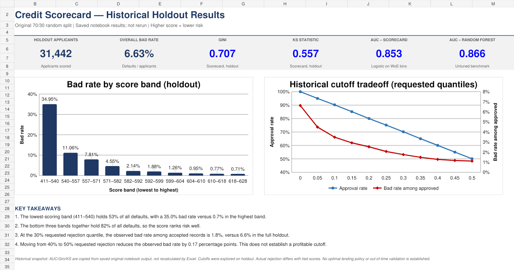

# Credit Scoring Scorecard

[](https://github.com/Jessica-8-mifta/credit-scoring-scorecard/actions/workflows/ci.yml)

**An interpretable two-year serious-delinquency scorecard using Weight of Evidence and logistic regression, with a Random Forest benchmark.** The project turns model predictions into points and examines the tradeoff between accepting more records and their observed delinquency rate.

**Author:** Miftahul Jannat Jessica

## Evidence and current status

The original notebook has been recovered and is preserved with its saved outputs. Its training-only preprocessing code and historical aggregates have been reviewed. The original input file, `train.csv.zip`, and fitted model have not been supplied, so the original model scores have **not been independently rerun**.

| Evidence | Status |
|---|---|
| Original notebook and saved results | [Preserved](notebooks/original_credit_scoring.ipynb) |
| Original holdout tables | [Reconciled against saved notebook output](reports/legacy_audit.json) |
| Revised pipeline | Implemented and tested end to end on synthetic data |
| New real-data test metrics / exact original points table | Pending the original input data; not invented from rounded logs |

The two runs have different purposes. Historical metrics describe the original 70/30 experiment. The [synthetic demonstration](reports/synthetic_demo/README.md) checks that the revised software executes and exports its calculations; it is **not a credit-performance benchmark**.

## Original experiment

Source: [Give Me Some Credit](https://www.kaggle.com/competitions/GiveMeSomeCredit), using a local file named `train.csv.zip`. The saved notebook loaded **104,805 records and 10 predictors**, with a 6.63% target rate. The file's upstream sampling or preprocessing history is unknown. It must not be assumed to be an untouched copy of Kaggle's original training file.

The target is `SeriousDlqin2yrs`: serious delinquency within two years. “Bad” in the tables refers to that flag, not a regulatory default or a verified loss amount. The data concerns consumer credit; no SME-lending validation is claimed.

The original notebook split data 70/30, then fitted missing-value medians, 99th-percentile caps and WoE mappings using training data only. Utilization and age cutpoints were manually typed after training-data exploration. Logistic regression used six variables: utilization, age, income and three delinquency-history counts. The untuned Random Forest used all raw predictors plus an income-missing flag.

| Historical holdout metric | WoE logistic | Random Forest |
|---|---:|---:|
| AUC, rounded saved output | 0.853 | 0.866 |
| Gini, rounded saved output | 0.707 | Not reported |
| KS, rounded saved output | 0.557 | Not reported |

The holdout contains **31,442 records and 2,085 bads**. The lowest-scoring band contains **53.1% of holdout bads**; the bottom three contain **81.5%**. The audit script recomputes these facts from the exported counts. It does not recompute AUC, KS or fitted coefficients from borrower-level predictions.



[Historical Excel dashboard](outputs/credit_scorecard_dashboard.xlsx) · [Score bands](outputs/score_bands.csv) · [Historical cutoff table](outputs/cutoff_table.csv)

The Excel workbook is a historical snapshot. Its AUC/Gini/KS are copied from saved notebook output; the count and rate summaries use spreadsheet formulas. Historical cutoff choices were explored on the holdout itself. At the nominal 30% rejection quantile, the realized rejected share was **29.85%**, acceptance was **70.15%**, and the accepted bad rate was **1.76%**. Boundary ties explain why requested and realized shares differ. This is retrospective selection analysis, not evidence of an optimal or profitable policy.

## Revised methodology

1. **Audit the supplied file.** Require named numeric predictors and a binary target. Record the input checksum, row exclusions, missingness, suspicious delinquency counts and summary statistics. Ignore extra identifier columns rather than accidentally treating them as predictors. Exclude missing/under-18 ages using an outcome-independent eligibility rule.
2. **Split before fitting.** Five stratified feature-group folds produce approximately 60% training, 20% validation and 20% test data. Equal raw feature vectors stay in one partition. This guards against exact feature duplicates; it does not prove borrower identity or temporal independence.
3. **Fit preprocessing and WoE on training only.** Preserve the original six scorecard features. Derive exact quantile cutpoints anew, including the original design of merging the lowest three utilization deciles. Use 0/1/2/3+ delinquency categories and a separate missing-income bin. Replace delinquency counts at or above 90 with missing values; fit medians and caps on training only.
4. **Export the bin evidence.** Record raw good/bad counts, 0.5 smoothing, WoE, IV, sparse-bin flags and validation/test bin rates. Report monotonicity rather than assuming it. A bin with no training support gets an explicit neutral WoE of zero and a usage diagnostic. A high IV is a review flag, not proof of leakage.
5. **Fit fixed baseline models.** Logistic regression uses six WoE features. The Random Forest uses all ten predictors plus the income-missing flag, with 300 trees and `min_samples_leaf=50`. No test-driven feature or hyperparameter selection occurs in this workflow.
6. **Freeze cutoffs on validation.** The illustrated policy uses a predeclared validation score quantile, default 30%, not a profit-optimized threshold. Apply that same numeric cutoff to test data. Report actual acceptance, rejected goods, captured bads and accepted bad rate. All boundary ties are accepted; the zero-rejection policy accepts every record.
7. **Evaluate ranking and probabilities.** Export AUC, Gini, KS, Brier score, log loss, calibration tables and a training-prevalence baseline. Add paired bootstrap AUC intervals for both models and their difference. Resample feature-duplicate clusters to preserve those dependencies. Intervals are conditional on the fitted models and split, not retraining uncertainty.

Validation is for development. Once test results have been inspected, repeated adjustments require a new evaluation design; repeatedly rerunning seeds is not an untouched final test. A grouped random split and low score PSI do not establish stability over time.

## Scorecard calculation

The scale retains **600 points at 50:1 good-to-bad odds**, with **20 points to double good-to-bad odds**:

```text
factor = 20 / ln(2)
offset = 600 - factor × ln(50)
score = offset - factor × logit(predicted probability of bad)
```

Each feature contributes its share of the offset/intercept and its coefficient × WoE effect. `scorecard_points.csv` contains full-precision and rounded points. Their exact sum must match the model score within numerical tolerance. With six separately rounded contributions, the absolute rounding-error bound is 3 points. Cutoff comparisons use the exact score, preventing rounding from silently changing policy membership.

Each run also exports a [worked-example structure](reports/synthetic_demo/worked_example.json) for a clearly hypothetical record. The published example and points table use synthetic training data; they are not the recovered original fitted scorecard.

## Run the project

Use Python 3.10+ from the repository root:

```bash
git clone https://github.com/Jessica-8-mifta/credit-scoring-scorecard.git
cd credit-scoring-scorecard
python -m pip install -r requirements.txt
python -m credit_scorecard --help
```

Place your locally held labeled data in `data/train.csv.zip` or supply a CSV path. A ZIP must contain one CSV. Data is not redistributed; obtain it from the original source and follow its terms. Both named-column files with and without an extra index column are supported.

```bash
python -m credit_scorecard train --data data/train.csv.zip --output runs/baseline
```

This is a new run using the revised protocol, not a guarantee of reproducing 0.853 AUC. Preserve the entire output folder:

| Output | Purpose |
|---|---|
| `data_audit.json`, `split_manifest.csv` | Data lineage and partition membership |
| `run.json`, `environment.txt` | Requested settings, exact installed versions, platform and code revision |
| `metrics.json`, calibration CSVs | Computed model metrics, probability assessment and bootstrap intervals |
| `scorecard_points.csv`, `score_scaling.json` | Full points calculation and fitted preprocessing parameters |
| `bin_audit.csv`, `iv_diagnostics.csv` | Bin counts, WoE/IV, sparse support and monotonicity diagnostics |
| `cutoff_table.csv`, score-band CSVs | Validation-defined policies and training-defined score bands |
| `worked_example.json` | Hypothetical record with per-feature contributions |
| `model.joblib`, `model_manifest.json` | Fitted models and file checksum |
| `dashboard.html`, `dashboard.png` | Report generated from that run's exports |

Every training run requires a new output directory. To score a separate local file:

```bash
python -m credit_scorecard predict --model runs/baseline/model.joblib --data data/new_records.csv --output runs/scored_records.csv
```

Predictions contain row positions, scores and estimated delinquency probabilities; the command does not issue lending approvals. Only load trusted, version-compatible serialized models. Raw data, model files and run folders are excluded from Git.

For a quick execution check without the original data:

```bash
python -m credit_scorecard demo --output runs/synthetic_demo
```

The demo generates synthetic data and runs actual fitting, evaluation and exports. Its smaller forest and bootstrap budget are documented in its run metadata. It never substitutes synthetic results for the historical credit metrics.

Prefer a notebook? Use [notebooks/credit_scoring.ipynb](notebooks/credit_scoring.ipynb). The [original notebook](notebooks/original_credit_scoring.ipynb) is retained for provenance and is not the recommended revised workflow.

## Validation and limitations

```bash
python -m unittest discover -s tests -v
python scripts/audit_legacy.py --output runs/legacy_audit.json
python scripts/check_repository.py
```

Tests cover score anchors, doubling odds, exact/rounded points reconciliation, training-only preprocessing, missing-income handling, WoE calculations, unsupported bins, duplicate-group separation, boundary ties, frozen validation cutoffs, bootstrap pairing, serialization, prediction and a complete run with independently recomputed AUC. CI runs on Python 3.10 and 3.12. Tests and the synthetic demonstration verify software behavior; they do not validate a real lending system.

The original data's upstream lineage remains unknown. No out-of-time test, reject inference, subgroup fairness evaluation, regulatory validation or profitability model is provided. Calibration is measured by the revised pipeline; no extra calibration model is fitted automatically. New real-data metrics and original-scorecard reconstruction require the original file. See [methodology](docs/METHODOLOGY.md) and [data requirements](docs/DATA.md).

## Repository structure

```text
src/credit_scorecard/        Model, evaluation, reporting and command-line workflow
notebooks/credit_scoring.ipynb  Revised guided workflow
notebooks/original_credit_scoring.ipynb  Supplied original with saved outputs
outputs/                    Historical aggregate exports and corrected historical dashboard
reports/legacy_audit.json    Reconciliation of historical evidence
reports/synthetic_demo/      Clearly labeled, computed execution example
tests/                      Calculation and end-to-end tests
scripts/                    Historical reconciliation and repository checks
docs/                       Methodology and data documentation
.github/workflows/ci.yml     Automated checks
```

## References and license

- [Give Me Some Credit competition](https://www.kaggle.com/competitions/GiveMeSomeCredit)
- [Scikit-learn: avoiding leakage](https://scikit-learn.org/stable/common_pitfalls.html)
- [Grouped stratification](https://scikit-learn.org/stable/modules/generated/sklearn.model_selection.StratifiedGroupKFold.html), [probability calibration](https://scikit-learn.org/stable/modules/calibration.html) and [threshold selection](https://scikit-learn.org/stable/modules/classification_threshold.html)

Original code is provided under [MIT](LICENSE). The dataset and dependencies retain their own terms. No personal borrower data or credentials are required in the public repository.
