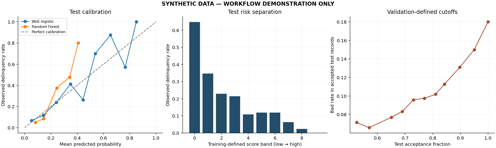

# Synthetic execution demonstration

**These results use engineered synthetic data, not Give Me Some Credit borrowers.** They demonstrate that the revised training, evaluation, scorecard export and reporting workflow executes. They must not be quoted as credit-model performance or combined with the original 0.853 AUC.

The fixture has 2,000 records generated with seed 42. The actual workflow was run with 30 Random Forest trees, 100 paired bootstrap draws and the standard six scorecard variables. See [run settings](run.json), [data audit](data_audit.json) and [computed metrics](metrics.json). No raw synthetic row data or serialized model is published; regenerate it with:

```bash
python -m credit_scorecard demo --output runs/synthetic_demo
```



[Points table](scorecard_points.csv) · [Score scaling](score_scaling.json) · [Hypothetical worked example](worked_example.json) · [Bin audit](bin_audit.csv) · [IV diagnostics](iv_diagnostics.csv) · [Validation-defined cutoffs](cutoff_table.csv)

Full-precision point sums matched model scores with a maximum absolute error of approximately 1.14e-13 in this run. Separately rounded point sums stayed inside the three-point theoretical bound. These checks establish arithmetic consistency, not real-world risk validity. Small-bin calibration estimates in this deliberately small fixture can be unstable; inspect the exported bin counts.

Installed package versions are recorded in [environment.txt](environment.txt). Results can vary across library versions. The saved run was executed before the implementation commit was published, so its code revision may be unavailable; the versioned implementation and tests in this repository provide the source snapshot.
